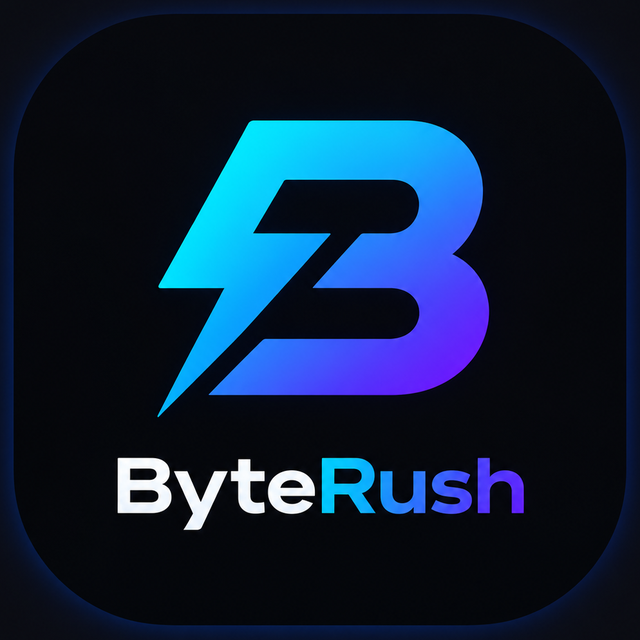

# ByteRush
<p align="center"></p>

(The project folder is still called `algocoach`; that is fine.)

## Desktop app (offline, Mac + Windows)
`desktop/` wraps ByteRush in its own app window (Electron) with Java bundled, so it runs fully offline.
GitHub builds it for free: push a tag like `v1.0.0` and `.github/workflows/release.yml` publishes
`ByteRush-mac-arm64.dmg`, `ByteRush-mac-x64.dmg` and `ByteRush-windows-x64.exe` as a GitHub Release.
The download website lives in `site/` and is published to GitHub Pages by `.github/workflows/pages.yml`.

## Just want to use it? (no terminal needed)
1. Unzip **ByteRush.zip**.
2. Double-click **Start ByteRush.command** (Mac), **Start ByteRush.bat** (Windows) or run `./start-byterush.sh` (Linux).
3. The first time it gets itself ready (2-3 minutes, needs internet) and may offer to install Node.js and the Java JDK. Say yes.
4. Your browser opens with ByteRush. Keep the window open while you use it. Details: **READ ME FIRST.txt**.

Your data lives in `ByteRush-Data` in your home folder, so you can replace the ByteRush folder with a newer version safely.

**Want it online for everyone? See [DEPLOY.md](DEPLOY.md)** (Dockerfile + Render, free).

## One-time setup
1. Node 20+, Docker Desktop running, then: `docker pull eclipse-temurin:21-jdk`
2. Start backend and frontend (below), open the **Settings** tab, and paste a free Gemini key
   (create one at https://aistudio.google.com/app/apikey). No .env editing needed.

## Run
```
cd backend  && npm install && npm run dev     # :3001 (localhost only)
cd frontend && npm install && npm run dev     # :5173
```

## Features
- **Language dropdown** (top right): **Java**, **Python**, **C**, **C++**, **JavaScript** or **HTML, CSS & JS**.
  **Python, C and C++** have the same kind of playground as Java: write code, type input in the Input tab, press Run, and see the output, compile errors with line markers, or crashes explained (segmentation fault, Python tracebacks). The Error Coach works there too.
  **Questions, Notebook and Practice** work in Java, Python, C, C++ and JavaScript. Each language has its own history, notebook (Q1, Q2, ... and folders), attempts and graded tests, and solutions and hidden tests are written and verified in the language you chose.
  **JavaScript** is a playground like Java's: write code, press Run, and see `console.log` output in a console (with an Input tab: `input()` reads a line). It runs in your browser inside a sandbox, with a 5-second limit, so infinite loops are stopped. The website playground has **HTML on top, CSS and JavaScript below** (side by side or stacked; every editor can be minimized with its arrow) next to a live preview with a console for `console.log` and errors. It downloads `index.html`, `style.css` and `script.js`, or all three as one `.zip` (Chrome/Edge let you pick the Desktop for single files). **💾 Save page** keeps named pages in your browser
  (📁 My pages: open, rename, delete) and **⛶ Full page** shows the preview full screen with desktop / tablet / mobile widths.
- **Playground**: real Java compile + run in a Docker sandbox, with an Input tab (stdin). **Analyze** rates efficiency, complexity and
  estimated memory. **Visualize** replays your code line by line (AI-simulated trace) and highlights the running line in the editor.
  **Explain this error** is an Error Coach: explanation, then hint, stronger hint, and only then the fix.
- **Questions**: you can **upload a photo** of a question (or paste/drop an image): ByteRush reads it into text, then gets the solution. **Get solution** and **Find similar questions** (3 questions + LeetCode picks) are separate AI requests. History keeps everything.
- **Practice**: Run with your own input, or **Submit** to grade against verified hidden tests. Score = 70 correctness
  + 15 efficiency + 15 code quality (the last two on request, 1 AI request, scaled by tests passed).
- **Notebook**: paste your own question and code on a notebook-style page, save it as Q1, Q2, ... (numbers never get reused),
  then **Run** (with input), **Analyze**, **Dry run** (step-by-step trace) and **Similar** (3 questions + LeetCode picks). Stored per browser in public mode.
  The notebook has **folders** (a built-in General folder plus your own, e.g. Arrays; deleting a folder moves its questions to General)
  and a **⭐ Starred** section for important questions.
- **Notes** (every language; each language keeps its own notes): a clean page with a title, a text area for what you learned, and a code template in the chosen language next to it that you can run with input. Notes save automatically and are stored like the notebook (in `ByteRush-Data` on your computer).
  - **Markdown** with a **Preview** toggle: headings, lists (nested, with `[ ]` tasks), quotes, tables, links and fenced code blocks that are syntax-coloured (a block with no language uses the note's language). It is rendered safely: HTML in a note stays text, and only `http(s)`/`mailto` links open.
  - **Tags and pin**: add up to 8 tags per note, filter the list by tag (new notes inherit the tags you are filtering by), search matches tags too, and **📌 Pin** keeps a note at the top.
  - **Linked to questions**: press **📝 Take notes** on a Questions entry or a Notebook page to start a note linked to it (or reopen the one you already have); the note shows **Open question / Open notebook page** to jump back, and **Unlink** if you change your mind.
- **Progress**: level and title, a streak that survives one missed day, **three daily quests** (+20 XP bonus for all three), this week's activity, an activity map, XP per language, a **skill tree** that grows when you run real code (works in every language, no AI needed), **23 achievements** with progress bars, and attempt history with side-by-side comparison + AI explanation. Running the untouched starter template earns nothing, and the same program can't be farmed for skill points. Everything is stored in your browser.
- **Shortcut**: `Ctrl/⌘ + Enter` runs the code of the editor you are in (also from the Input box).
- **Settings**: Gemini key add/remove/test, model name, Dark / Light / System theme.
- XP comes only from real actions and is capped per day. Stored in your browser. One missed day never breaks a streak.
- Test cases are checked against the reference solution when the solution is generated, and hidden tests never leave the server.
- Not yet: daily challenge, personalized recommendations, backup/export, Supabase.

## Sharing it publicly (public mode)
For a permanent public site use [DEPLOY.md](DEPLOY.md). The notes below are for a temporary link from your own computer.
Public mode makes the app safe(r) for strangers: every visitor pastes their **own** free Gemini key (stored only in their browser,
never on the server), history is separate per browser, the server's Settings can't be changed, and requests are rate limited per IP.
The server never uses a key of its own in this mode.

Quick demo from your own computer (free, temporary link):
```
cd frontend && npm run build                 # builds the site; the backend then serves it
cd ../backend && npm run start:public        # PUBLIC_MODE=true, TRUST_PROXY=1, localhost:3001
brew install cloudflared                     # once
cloudflared tunnel --url http://localhost:3001
```
Share the https://....trycloudflare.com address it prints. It only works while your computer is on and those commands run.

On a real server (needs Docker): run the backend with `PUBLIC_MODE=true HOST=0.0.0.0` behind a reverse proxy with HTTPS
(set `TRUST_PROXY=1` only if a proxy is in front). Use a dedicated machine: visitors' Java runs there, inside Docker
(no network, 256 MB, 1 CPU, 5 s limit), but it is still code from strangers.
Limits: 300 requests/min per IP overall, 20/min for running code and AI features; history older than 30 days of inactivity is deleted.
